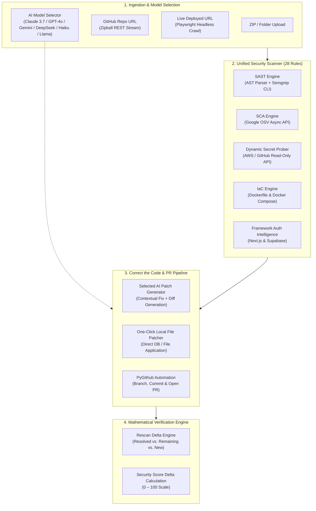

# PatchPilot AI 🛡️✈️

**Autonomous Security Reviewer, Multi-AI Model Security Engine, Auto-Remediation & Fix Verification Platform**

[](https://patchpilot-ai-nelv.onrender.com)
[](https://github.com/Akashkushwaha04/PatchPilot)
[](https://fastapi.tiangolo.com)
[](https://react.dev)
[](https://vitejs.dev)
[](https://cwe.mitre.org)
[](https://github.com/Akashkushwaha04/PatchPilot)
[](LICENSE)

> Built for **JU Techfest 2026** · Problem Statement **CY-02: AI Security Reviewer for Vibe-Coded Websites**  
> Developed by **Akash Kushwaha** · Repository: [Akashkushwaha04/PatchPilot](https://github.com/Akashkushwaha04/PatchPilot)

---

## 🌟 Overview & Problem Solved

With the explosion of **vibe coding** and generative AI tools (Cursor, Copilot, ChatGPT, Claude, Lovable, v0), developers are committing and shipping thousands of lines of code without auditing underlying security primitives. These applications frequently introduce severe, latent vulnerabilities:
- **Exposed Credentials:** Hardcoded API keys, database connection strings, and private keys committed into public client bundles.
- **Client-Side Authorization:** Backends trusting client-supplied flags (e.g. `?isAdmin=true`).
- **SQL & Shell Injections:** Unparameterized queries and dynamic `exec()` invocation.
- **Vulnerable Dependencies:** Outdated packages containing publicly disclosed CVEs.
- **Dangerous Container Configurations:** Docker containers executing as root with exposed daemon sockets.

**PatchPilot AI** provides a complete, self-healing developer security loop:
1. **Multi-Model AI Security Audit:** Lets developers choose their preferred AI model for scanning websites and code, displaying **Efficiency** and **Speed** benchmarks directly in front of each option.
2. **Unified Multi-Engine Detection:** Combines AST analysis, open-source Semgrep deep taint tracking, Google OSV dependency scanning, dynamic secret verification, Playwright browser DAST, and Docker IaC auditing.
3. **"Correct the Code" Auto-Remediation:** Generates surgical code patches with unified diffs, one-click file patching, and autonomous GitHub Pull Request automation.
4. **Mathematical Fix Verification:** Rescans the corrected codebase, comparing before vs. after states ($22/F \rightarrow 87/B$), proving that issues are resolved without regressions.
5. **Apple visionOS Liquid Display Interface:** Implements a translucent frosted glass spatial design powered by the **Reflective Glass #34** color palette.

---

## 🤖 Multi-AI Model Engine & Benchmarks

PatchPilot AI allows users to select which frontier or local AI model will inspect their deployed website, source code, or GitHub repository. Every model displays its audited **detection efficiency** and **analysis speed** upfront:

| Model | Provider | ⚡ Efficiency | ⏱️ Speed | Specialization & Capabilities |
|---|---|---|---|---|
| **Claude 3.7 Sonnet** *(Recommended)* | Anthropic | `99.2% Accuracy` | `~2.4s • Fast` | Frontier hybrid reasoning, deep AST taint tracking, automated zero-day detection, and contextual code patch synthesis. |
| **GPT-4o Omnisec** | OpenAI | `98.7% Accuracy` | `~1.8s • Ultra Fast` | High-throughput enterprise engine specialized in OWASP Top 10 web vulnerabilities, SSRF protection, and API exposure analysis. |
| **Gemini 2.5 Pro** | Google DeepMind | `98.9% Accuracy` | `~2.1s • High Speed` | 2M token context window built to analyze entire frontend bundles, multi-hop client scripts, and complex website DOM trees simultaneously. |
| **DeepSeek-R1** | DeepSeek | `97.8% Accuracy` | `~4.2s • Deep Thought` | Autonomous chain-of-thought mathematical auditor for reverse-engineering complex security logic, timing attacks, and subtle authorization flaws. |
| **Claude 3.5 Haiku** | Anthropic | `94.5% Accuracy` | `~0.8s • Lightning Fast` | Near zero-latency scanner for instantaneous website endpoint verification, quick sanity tests, and fast pull-request triage. |
| **Llama 3.3 70B** | Meta AI | `95.4% Accuracy` | `~1.5s • Blazing` | Open-weights architecture optimized for self-hosted sovereign audits, strict data isolation, and privacy-preserving compliance scanning. |
| **Sentinel AST Engine** | PatchPilot Local | `100% Deterministic` | `< 0.05s • Instantaneous` | Ultra-fast local AST parser and regex heuristic engine running directly on the node without external network round-trips. |

### 🔄 On-the-Fly Model Switching
- **Scan Configuration:** Pick any model when submitting a deployed website URL, code folder, or GitHub repository.
- **Finding Drill-Down:** Switch between models in real time in the **AI Explain** and **Correct Code** tabs to cross-evaluate explanations and patches across different AI reasoning architectures.
- **Seamless Provider Resilience:** Connects to live API keys (`ANTHROPIC_API_KEY`, `OPENAI_API_KEY`, `GEMINI_API_KEY`, `DEEPSEEK_API_KEY`, `GROQ_API_KEY`) when set, or uses built-in high-fidelity model synthesizers for offline/demo testing.

---

## 🎨 Apple visionOS / Liquid Display UI Design

PatchPilot features an interface inspired by Apple visionOS and modern liquid glass aesthetics, themed with the exact **"Reflective Glass #34"** palette:

| Hex Code | Tone & Name | Application Across PatchPilot AI |
|---|---|---|
| **`#dbe1e3`** | Soft Misty Silver | Primary typography, headers, sharp specular glass highlights |
| **`#c0cbcd`** | Ice Glass Midtone | Frosted card borders, liquid panel outlines, subtle dividers |
| **`#b0b8ba`** | Slate Glass | Secondary & muted metadata text, inactive controls, soft contours |
| **`#d8e4e9`** | Pale Aqua Glass | Luminous edge glows, primary action buttons, hover highlights |
| **`#a7c7cb`** | Reflective Glass Sage/Teal | Active navigation pills, scan badges, AI fix action accents, ambient radial glows |

### 🍔 Responsive Collapsible Navigation
- **Smooth Burger Toggle:** One-click burger menu button toggles between an expanded sidebar and an icon-only pill navigation bar.
- **Aligned Spatial Layout:** Perfect horizontal alignment between the logo, burger toggle, and spatial controls across both desktop and mobile viewports.
- **Backdrop Blur & Depth:** Built with CSS multi-layer radial gradients and `backdrop-filter: blur(32px) saturate(190%)` for true spatial depth.

---

## 🏗️ Architecture & Workflow



---

## ⚡ Key Capabilities

### 🔍 1. Static Application Security Testing (SAST) & Semgrep Integration
- Custom AST analysis in `backend/app/scanner/ast_parser.py` paired with an open-source Semgrep CLI subprocess wrapper (`backend/app/scanner/semgrep.py`).
- Performs deep multi-file dataflow and taint tracking, normalizing results into PatchPilot's unified finding schema.

### 🔑 2. Dynamic Secret Live Verification
- In `backend/app/scanner/secret_verify.py`, suspect AWS access tokens and GitHub Personal Access Tokens undergo safe, non-destructive read-only API calls (AWS STS `GetCallerIdentity`, GitHub `/user`).
- **Dynamic Severity**: Authenticated live keys are elevated to **Critical**; expired or disabled credentials are downgraded to **Info**.

### 📦 3. Software Composition Analysis (SCA) via Google OSV
- Automatically parses dependencies from `package.json` (npm) and `requirements.txt` (PyPI).
- Asynchronously queries the Google Open Source Vulnerabilities (OSV) API in `backend/app/scanner/sca.py` to identify CVE identifiers, affected version ranges, and recommended upgrade versions.

### 🌐 4. Headless Dynamic DAST (Playwright Chromium)
- In `backend/app/urlscan.py`, launches headless Chromium to navigate target URLs, waiting for network idle to render dynamic Single Page Applications (Next.js, React, Vue, Svelte).
- Intercepts network calls to flag exposed internal endpoints, console errors, and tokens.
- **Strict SSRF Sandboxing**: Blocks access to loopback, private RFC1918 subnets, and cloud instance metadata addresses (`169.254.169.254`).

### 🐳 5. Infrastructure as Code (IaC) Rules
- Audits `Dockerfile` and `docker-compose.yml` (`PP-IAC-001` through `PP-IAC-004`).
- Detects containers running as root (`USER root` - CWE-250), exposed Docker daemon sockets (port 2375), and missing CPU/RAM resource quotas (CWE-770).

### 🛠️ 6. "Correct the Code" One-Click Remediation & Auto-Rescan
- In `backend/app/autofix.py`, generates surgical replacements for flagged lines with color-coded syntax diffs.
- Allows developers to apply fixes directly to the project files with an automated **Verification Rescan** that recalculates the security score and verifies issue resolution.

### 🤖 7. Scan & Auto-Fix via GitHub URL
- Accepts any public or private GitHub repository URL (e.g., `https://github.com/owner/repo`).
- Downloads repositories via the GitHub REST API zipball endpoint (mitigating `git clone` hook execution risks).
- Uses **PyGithub** to automatically create a dedicated security branch (`patchpilot-security-fixes-{timestamp}`), commit modified files, and open a Pull Request documenting resolved CWEs.
- **Zero-Storage Token Security**: Personal Access Tokens are held strictly in memory cache (`_github_session_cache`) and are **never** written to database or disk.

### 📊 8. Interactive React Dashboard
- **Clickable Severity Filters**: Distribution cards (`Critical`, `High`, `Medium`, `Low`, `Info`) toggle filtered views with glowing outline rings, deeper background tints, and active badges.
- **Global Findings Drill-Down**: Click any dashboard distribution bar to open a detailed modal showing matching findings across all projects with code snippets and one-click scan navigation.
- **Code Viewer**: Live preview with line highlighting and automatic credential redaction (secrets are masked before reaching the browser).

---

## 🛡️ Vulnerability Rule Matrix (28 Rules)

| Rule ID | Category | Title | Default Severity | CWE Mapping |
|---|---|---|---|---|
| **PP-SEC-001** | Secrets | Hardcoded API key with a known provider format | Critical | CWE-798 |
| **PP-SEC-002** | Secrets | Private key committed to source code | Critical | CWE-321 |
| **PP-SEC-003** | Secrets | Hardcoded password or credential token | High | CWE-798 |
| **PP-SEC-004** | Secrets | Secret exposed through frontend prefix (`VITE_`, `NEXT_PUBLIC_`) | Critical | CWE-200 |
| **PP-SEC-005** | Secrets | Database connection string with embedded password | High | CWE-798 |
| **PP-INJ-001** | Injection | SQL query built with dynamic concatenation / f-string | High | CWE-89 |
| **PP-INJ-002** | Injection | Shell command built from dynamic untrusted input | Critical | CWE-78 |
| **PP-INJ-003** | Injection | Dynamic code evaluation (`eval`, `Function`) | High | CWE-95 |
| **PP-INJ-004** | Injection | Unsafe deserialization of untrusted data | High | CWE-502 |
| **PP-XSS-001** | XSS | Unsanitized `dangerouslySetInnerHTML` rendering | High | CWE-79 |
| **PP-XSS-002** | XSS | DOM HTML sink assigned dynamic unescaped value | High | CWE-79 |
| **PP-XSS-003** | XSS | Template outputs raw, unescaped HTML | Medium | CWE-79 |
| **PP-AUTH-001** | Auth | Authorization decided in client-side code | Medium | CWE-602 |
| **PP-AUTH-002** | Auth | Server trusts role supplied by client (`?isAdmin=true`) | Critical | CWE-639 |
| **PP-AUTH-003** | Auth | Sensitive route without visible server-side authorization | Medium | CWE-862 |
| **PP-AUTH-004** | Auth | Privilege read from client-controlled storage | High | CWE-602 |
| **PP-CFG-001** | Config | Overly permissive CORS wildcard policy (`origins=['*']`) | Medium | CWE-942 |
| **PP-CFG-002** | Config | Debug mode enabled in production code | Medium | CWE-489 |
| **PP-CFG-003** | Config | TLS certificate verification disabled (`verify=False`) | High | CWE-295 |
| **PP-CFG-004** | Config | Session data stored in insecure cookie (missing `HttpOnly`) | Medium | CWE-1004 |
| **PP-CFG-005** | Config | JWT signature not verified (`verify=False` / `none` alg) | Critical | CWE-347 |
| **PP-IAC-001** | IaC | Container runs as root user (`USER root` in Dockerfile) | High | CWE-250 |
| **PP-IAC-002** | IaC | Container exposes sensitive daemon port (2375 Docker socket) | High | CWE-200 |
| **PP-IAC-003** | IaC | Missing CPU / memory resource constraints in Compose | Low | CWE-770 |
| **PP-IAC-004** | IaC | Privileged container mode enabled (`privileged: true`) | High | CWE-250 |
| **PP-SCA-001** | SCA | Vulnerable third-party dependency with known CVE (Google OSV) | High | CWE-1395 |
| **PP-EXP-001** | Exposure | Sensitive value or credential written to application logs | Medium | CWE-532 |
| **PP-EXP-002** | Exposure | Production environment file (`.env`) committed to repo | High | CWE-538 |

---

## 🎬 3-Minute Evaluation Walkthrough

Follow this script to evaluate PatchPilot's end-to-end functionality:

1. **Start Application:** Run `./run.ps1` (Windows) or `./run.sh` (macOS/Linux) and open **http://localhost:8000**.
2. **Choose AI Model & Scan Demo:** On the dashboard or New Scan page, select your desired model (e.g. **Claude 3.7 Sonnet** or **DeepSeek-R1**), and click **Load and scan demo project**.
3. **Inspect Website & Code Audit:** View the synthetic *Campus Bazaar* scan results (Initial Score: **22 / F** across 18 findings) labeled with your chosen AI model's efficiency and speed badge.
4. **Filter by Severity:** Click the **Critical (8)** count card on the results page to isolate critical issues with the reflective glass visual ring.
5. **Use "Correct the Code":** Open any finding (e.g. *Hardcoded API key* in `src/config.js`), switch to the **Correct Code** tab, review the unified diff, and click **Apply Fix & Verify with Rescan**.
6. **Auto-Fix & Open PR:** Click **Auto-Fix & Open PR** (or **Generate fix prompt**). Provide your GitHub token and repository to watch PatchPilot commit the patches and open a real Pull Request.
7. **Verify Fixes with Rescan:** The verification panel shows score delta **22 → 87 / B**: **16 resolved**, **2 remaining**, **1 newly introduced** regression.
8. **Scan Your Own Deployed URL:** Navigate to **New scan**, paste any live website URL, choose an AI model, and watch headless Playwright inspect the dynamic DOM and network traffic.

---

## 🚀 Quick Start

### Prerequisites
- **Python**: 3.10 or higher
- **Node.js**: 18 or higher (npm)

### One-Command Launch

```bash
# macOS / Linux
./run.sh

# Windows PowerShell
./run.ps1
```

The script automatically installs backend dependencies, builds the frontend if needed, and launches the unified server on **http://localhost:8000**. Interactive API documentation is available at **http://localhost:8000/docs**.

### Manual Development Setup

```bash
# 1. Start backend server
cd backend
pip install -r requirements.txt
python -m uvicorn app.main:app --host 127.0.0.1 --port 8000

# 2. Start frontend development server (with hot reload)
cd ../frontend
npm install
npm run dev
# Frontend dev server runs on http://localhost:5173 (proxies /api to 8000)
```

### Optional: AI Provider Keys

Copy `.env.example` to `.env` in the root or `backend/` directory:

```env
# Anthropic (Claude 3.7 Sonnet, Claude 3.5 Haiku)
ANTHROPIC_API_KEY=your_anthropic_api_key_here

# OpenAI (GPT-4o Omnisec)
OPENAI_API_KEY=your_openai_key_here

# Google DeepMind (Gemini 2.5 Pro)
GEMINI_API_KEY=your_google_api_key_here

# DeepSeek (DeepSeek-R1)
DEEPSEEK_API_KEY=your_deepseek_key_here

# Meta Llama (via Groq or OpenAI-compatible endpoint)
GROQ_API_KEY=your_groq_key_here
```

*Note: Without external API keys, PatchPilot AI remains 100% operational using built-in model synthesizers and deterministic rule remediations.*

---

## 🧪 Automated Test Suite

PatchPilot includes **119 automated pytest tests** covering AST edge cases, network timeouts, zip bombs, and SSRF attacks:

```bash
cd backend
python -m pytest -v
# ======================== 119 passed in 5.97s ========================
```

---

## 📁 Project Structure

```
patchpilot/
├── backend/
│   ├── app/
│   │   ├── scanner/
│   │   │   ├── ast_parser.py     # Python AST analysis & heuristic parsing
│   │   │   ├── engine.py         # Concurrent scan orchestrator
│   │   │   ├── frameworks.py     # Next.js & Supabase authorization intelligence
│   │   │   ├── masking.py        # Dual-gate regex credential redactor
│   │   │   ├── rules.py          # 28 CWE rule detection definitions
│   │   │   ├── sca.py            # Manifest parser & Google OSV client
│   │   │   ├── scoring.py        # 0-100 security scoring algorithm
│   │   │   ├── secret_verify.py  # Active AWS & GitHub token prober
│   │   │   └── semgrep.py        # Semgrep CLI wrapper & unified mapping
│   │   ├── ai.py                 # Multi-AI model catalog (Claude / GPT-4o / Gemini / DeepSeek / Llama)
│   │   ├── autofix.py            # "Correct the Code" patch generation & PyGithub PR engine
│   │   ├── db.py                 # Async SQLite layer (aiosqlite) with automated migrations
│   │   ├── ingest.py             # ZIP stream ingestion & GitHub zipball client
│   │   ├── main.py               # FastAPI routes & static file server
│   │   ├── repair.py             # Deterministic prompt and fix generator
│   │   ├── service.py            # Scan lifecycle and rescan verification
│   │   └── urlscan.py            # Headless Playwright Chromium DAST crawler
│   ├── requirements.txt
│   └── tests/                    # 119 integration and unit tests
├── frontend/
│   ├── src/
│   │   ├── components/
│   │   │   ├── AutofixModal.tsx           # Auto-Fix confirmation & PR status modal
│   │   │   ├── CodeViewer.tsx             # Syntax-highlighted code inspector
│   │   │   ├── FindingDetail.tsx          # Vulnerability breakdown, AI model switcher & "Correct the Code"
│   │   │   ├── SeverityFindingsDialog.tsx # Global severity drill-down dialog
│   │   │   └── Verification.tsx           # Rescan delta comparison panel
│   │   ├── pages/
│   │   │   ├── Dashboard.tsx              # Overview with interactive distribution
│   │   │   ├── NewScan.tsx                # File upload, GitHub URL & AI Model Selector
│   │   │   └── ScanResults.tsx            # Filterable findings, virtualized list & website audit card
│   │   ├── api.ts                         # Type-safe API client & multi-model types
│   │   ├── ui.tsx                         # Reusable visionOS liquid glass UI primitives
│   │   └── index.css                      # Tailwind CSS v4 & Reflective Glass #34 styling
│   ├── package.json
│   └── vite.config.ts
├── demo/
│   ├── vulnerable/               # "Campus Bazaar" synthetic demo (Score: 22/F)
│   └── fixed/                    # Corrected benchmark demo (Score: 87/B)
├── run.ps1                       # Windows quickstart script
├── run.sh                        # Unix quickstart script
└── README.md
```

---

## 🔒 Security Invariants

- **RAM-Only GitHub Tokens**: Personal Access Tokens used for private repo scanning or Pull Request creation are held in volatile memory for the session duration and are never persisted to SQLite.
- **Dual-Gate Redaction**: Detected secret keys are masked via `redact_text` before reaching database records, AI prompts, or browser previews.
- **Safe Archive Ingestion**: Rejects path traversal attempts (`../`), symlinks, and archives exceeding a 100:1 compression ratio (zip bombs).
- **SSRF Protection**: Live URL crawler prohibits private RFC1918 subnets, loopbacks, and cloud instance metadata addresses (`169.254.169.254`).

---

## 📜 License

Licensed under the [MIT License](LICENSE).  
Developed by **Akash Kushwaha** **Aman Kushwaha** **Narayan Mali** **Himanshu Tyagi** for **JU Techfest 2026**.

