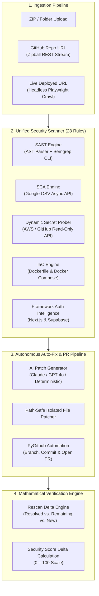

# PatchPilot AI 🛡️✈️

**Autonomous Security Reviewer, AI Auto-Remediation & Fix Verification Platform**

[](https://github.com/Akashkushwaha04/PatchPilot)
[](https://fastapi.tiangolo.com)
[](https://react.dev)
[](https://vitejs.dev)
[](https://cwe.mitre.org)
[](LICENSE)

> Built for **JU Techfest 2026** · Problem Statement **CY-02: AI Security Reviewer for Vibe-Coded Websites**  
> Developed by **Akash Kushwaha** · Repository: [Akashkushwaha04/PatchPilot](https://github.com/Akashkushwaha04/PatchPilot)

---

## 🌟 Overview & Problem Solved

With the explosion of **vibe coding** and AI code generators (Cursor, Copilot, ChatGPT, Claude), developers are committing and shipping thousands of lines of code without auditing underlying security primitives. These applications frequently introduce severe, latent vulnerabilities:
- **Exposed Credentials:** Hardcoded API keys, database connection strings, and tokens committed into source.
- **Client-Side Authorization:** Backends trusting client-supplied flags (e.g. `?isAdmin=true`).
- **SQL & Shell Injections:** Unparameterized queries and dynamic `exec()` execution.
- **Vulnerable Dependencies:** Outdated packages containing publicly known CVEs.
- **Dangerous Container Configurations:** Docker containers executing as root with exposed daemon sockets.

**PatchPilot AI** provides a complete, self-healing developer security loop:
1. **Multi-Engine Detection:** Combines AST analysis, open-source Semgrep deep taint tracking, Google OSV dependency scanning, dynamic secret verification, Playwright browser DAST, and Docker IaC auditing.
2. **Autonomous AI Auto-Fix:** Generates surgical code patches and opens detailed Pull Requests on GitHub referencing resolved MITRE CWEs.
3. **Mathematical Fix Verification:** Rescans the corrected codebase, comparing before vs. after states ($22/F \rightarrow 87/B$), proving that issues are resolved without regressions.

---

## 🏗️ Architecture & Workflow



---

## ⚡ Key Capabilities

### 🔍 1. Static Application Security Testing (SAST) & Semgrep Integration
- Custom AST analysis in `backend/app/scanner/ast_parser.py` paired with an open-source Semgrep CLI subprocess wrapper (`backend/app/scanner/semgrep.py`).
- Performs deep multi-file dataflow and taint tracking, normalizing results into PatchPilot's unified finding schema.

### 🔑 2. Dynamic Secret Live Verification
- In `backend/app/scanner/secret_verify.py`, suspect AWS access tokens and GitHub Personal Access Tokens undergo safe, non-destructive read-only API calls (AWS STS `GetCallerIdentity`, GitHub `/user`).
- **Dynamic Severity**: Authenticated live keys are elevated to **Critical**; expired or disabled credentials are downgraded to **Info**.

### 📦 3. Software Composition Analysis (SCA) via Google OSV
- Automatically parses dependencies from `package.json` (npm) and `requirements.txt` (PyPI).
- Asynchronously queries the Google Open Source Vulnerabilities (OSV) API in `backend/app/scanner/sca.py` to identify CVE identifiers, affected version ranges, and recommended upgrade versions.

### 🌐 4. Headless Dynamic DAST (Playwright Chromium)
- In `backend/app/urlscan.py`, launches headless Chromium to navigate target URLs, waiting for network idle to render dynamic Single Page Applications (Next.js, React, Vue, Svelte).
- Intercepts network calls to flag exposed internal endpoints, console errors, and tokens.
- **Strict SSRF Sandboxing**: Blocks access to loopback, private RFC1918 subnets, and cloud instance metadata addresses (`169.254.169.254`).

### 🐳 5. Infrastructure as Code (IaC) Rules
- Audits `Dockerfile` and `docker-compose.yml` (`PP-IAC-001` through `PP-IAC-004`).
- Detects containers running as root (`USER root` - CWE-250), exposed Docker daemon sockets (port 2375), and missing CPU/RAM resource quotas (CWE-770).

### 🛡️ 6. Framework-Aware Authorization Engine
- Recognizes Next.js `middleware.ts` JWT validation routines and Supabase migration Row Level Security (`CREATE POLICY` in `supabase/migrations`).
- Automatically dismisses false-positive access control warnings on guarded routes.

### 🤖 7. Scan & Auto-Fix via GitHub URL
- Accepts any public or private GitHub repository URL (e.g., `https://github.com/owner/repo`).
- Downloads repositories via the GitHub REST API zipball endpoint (mitigating `git clone` hook execution risks).
- Queries configured LLM providers (Anthropic / OpenAI) or deterministic rule remediations in `backend/app/autofix.py`.
- Uses **PyGithub** to automatically create a dedicated security branch (`patchpilot-security-fixes-{timestamp}`), commit modified files, and open a Pull Request documenting resolved CWEs.
- **Zero-Storage Token Security**: Personal Access Tokens are held strictly in memory cache (`_github_session_cache`) and are **never** written to database or disk.

### 📊 8. Interactive React Dashboard
- **Clickable Severity Filters**: Distribution cards (`Critical`, `High`, `Medium`, `Low`, `Info`) toggle filtered views with glowing outline rings, deeper background tints, and active badges.
- **Global Findings Drill-Down**: Click any dashboard distribution bar to open a detailed modal showing matching findings across all projects with code snippets and one-click scan navigation.
- **Code Viewer**: Live preview with line highlighting and automatic credential redaction (secrets are masked before reaching the browser).

---

## 🛡️ Vulnerability Rule Matrix (28 Rules)

| Rule ID | Category | Title | Default Severity | CWE Mapping |
|---|---|---|---|---|
| **PP-SEC-001** | Secrets | Hardcoded API key with a known provider format | Critical | CWE-798 |
| **PP-SEC-002** | Secrets | Private key committed to source code | Critical | CWE-321 |
| **PP-SEC-003** | Secrets | Hardcoded password or credential token | High | CWE-798 |
| **PP-SEC-004** | Secrets | Secret exposed through frontend prefix (`VITE_`, `NEXT_PUBLIC_`) | Critical | CWE-200 |
| **PP-SEC-005** | Secrets | Database connection string with embedded password | High | CWE-798 |
| **PP-INJ-001** | Injection | SQL query built with dynamic concatenation / f-string | High | CWE-89 |
| **PP-INJ-002** | Injection | Shell command built from dynamic untrusted input | Critical | CWE-78 |
| **PP-INJ-003** | Injection | Dynamic code evaluation (`eval`, `Function`) | High | CWE-95 |
| **PP-INJ-004** | Injection | Unsafe deserialization of untrusted data | High | CWE-502 |
| **PP-XSS-001** | XSS | Unsanitized `dangerouslySetInnerHTML` rendering | High | CWE-79 |
| **PP-XSS-002** | XSS | DOM HTML sink assigned dynamic unescaped value | High | CWE-79 |
| **PP-XSS-003** | XSS | Template outputs raw, unescaped HTML | Medium | CWE-79 |
| **PP-AUTH-001** | Auth | Authorization decided in client-side code | Medium | CWE-602 |
| **PP-AUTH-002** | Auth | Server trusts role supplied by client (`?isAdmin=true`) | Critical | CWE-639 |
| **PP-AUTH-003** | Auth | Sensitive route without visible server-side authorization | Medium | CWE-862 |
| **PP-AUTH-004** | Auth | Privilege read from client-controlled storage | High | CWE-602 |
| **PP-CFG-001** | Config | Overly permissive CORS wildcard policy (`origins=['*']`) | Medium | CWE-942 |
| **PP-CFG-002** | Config | Debug mode enabled in production code | Medium | CWE-489 |
| **PP-CFG-003** | Config | TLS certificate verification disabled (`verify=False`) | High | CWE-295 |
| **PP-CFG-004** | Config | Session data stored in insecure cookie (missing `HttpOnly`) | Medium | CWE-1004 |
| **PP-CFG-005** | Config | JWT signature not verified (`verify=False` / `none` alg) | Critical | CWE-347 |
| **PP-IAC-001** | IaC | Container runs as root user (`USER root` in Dockerfile) | High | CWE-250 |
| **PP-IAC-002** | IaC | Container exposes sensitive daemon port (2375 Docker socket) | High | CWE-200 |
| **PP-IAC-003** | IaC | Missing CPU / memory resource constraints in Compose | Low | CWE-770 |
| **PP-IAC-004** | IaC | Privileged container mode enabled (`privileged: true`) | High | CWE-250 |
| **PP-SCA-001** | SCA | Vulnerable third-party dependency with known CVE (Google OSV) | High | CWE-1395 |
| **PP-EXP-001** | Exposure | Sensitive value or credential written to application logs | Medium | CWE-532 |
| **PP-EXP-002** | Exposure | Production environment file (`.env`) committed to repo | High | CWE-538 |

---

## 🎬 3-Minute Evaluation Walkthrough

Follow this script to evaluate PatchPilot's end-to-end functionality:

1. **Start Application:** Run `./run.ps1` (Windows) or `./run.sh` (macOS/Linux) and open **http://localhost:8000**.
2. **Run Demo Scan:** Click **Load and scan demo project**. This scans *Campus Bazaar*, a synthetic marketplace with planted bugs, yielding score **22 / F** across 18 findings.
3. **Filter by Severity:** Click the **Critical (8)** count card on the results page to isolate only critical issues with the color-matched visual ring.
4. **Inspect Finding:** Click **Hardcoded API key** (`src/config.js:5`). Notice the token is masked (`sk-p••••••[masked 48 chars]`). Open **AI explanation → Explain this finding**.
5. **Auto-Fix & Open PR:** Click **Auto-Fix & Open PR** (or **Generate fix prompt**). Provide your GitHub token and repository to watch PatchPilot commit the patches and open a real Pull Request.
6. **Verify Fixes with Rescan:** Click **Rescan with fixes → Rescan with corrected demo**. The verification panel shows score delta **22 → 87 / B**: **16 resolved**, **2 remaining**, **1 newly introduced** regression.
7. **Scan Your Own Code / GitHub URL:** Navigate to **New scan**, paste any GitHub repo link, or upload a ZIP file.

---

## 🚀 Quick Start

### Prerequisites
- **Python**: 3.10 or higher
- **Node.js**: 18 or higher (npm)

### One-Command Launch

```bash
# macOS / Linux
./run.sh

# Windows PowerShell
./run.ps1
```

The script automatically installs backend dependencies, builds the frontend if needed, and launches the unified server on **http://localhost:8000**. Interactive API documentation is available at **http://localhost:8000/docs**.

### Manual Development Setup

```bash
# 1. Start backend server
cd backend
pip install -r requirements.txt
python -m uvicorn app.main:app --host 127.0.0.1 --port 8000

# 2. Start frontend development server (with hot reload)
cd ../frontend
npm install
npm run dev
# Frontend dev server will run on http://localhost:5173 (proxies /api to 8000)
```

### Optional: AI Provider Configuration

Copy `.env.example` to `.env` in the root or `backend/` directory:

```env
# Provider: "anthropic", "openai", or "none" (default: deterministic explanations)
PATCHPILOT_AI_PROVIDER=anthropic
ANTHROPIC_API_KEY=your_anthropic_api_key_here

# For OpenAI or any OpenAI-compatible API:
OPENAI_API_KEY=your_openai_key_here
OPENAI_BASE_URL=https://api.openai.com/v1
```

Without an API key, all features remain 100% operational using built-in deterministic remediation templates.

---

## 🧪 Automated Test Suite

PatchPilot includes **119 automated pytest tests** covering AST edge cases, network timeouts, zip bombs, and SSRF attacks:

```bash
cd backend
python -m pytest -v
# ======================== 119 passed in 5.97s ========================
```

---

## 📁 Project Structure

```
patchpilot/
├── backend/
│   ├── app/
│   │   ├── scanner/
│   │   │   ├── ast_parser.py     # Python AST analysis & heuristic parsing
│   │   │   ├── engine.py         # Concurrent scan orchestrator
│   │   │   ├── frameworks.py     # Next.js & Supabase authorization intelligence
│   │   │   ├── masking.py        # Dual-gate regex credential redactor
│   │   │   ├── rules.py          # 28 CWE rule detection definitions
│   │   │   ├── sca.py            # Manifest parser & Google OSV client
│   │   │   ├── scoring.py        # 0-100 security scoring algorithm
│   │   │   ├── secret_verify.py  # Active AWS & GitHub token prober
│   │   │   └── semgrep.py        # Semgrep CLI wrapper & unified mapping
│   │   ├── ai.py                 # LLM provider abstraction (Claude / OpenAI)
│   │   ├── autofix.py            # Patch generation & PyGithub PR engine
│   │   ├── db.py                 # Async SQLite layer (aiosqlite)
│   │   ├── ingest.py             # ZIP stream ingestion & GitHub zipball client
│   │   ├── main.py               # FastAPI routes & static file server
│   │   ├── repair.py             # Deterministic prompt and fix generator
│   │   ├── service.py            # Scan lifecycle and rescan verification
│   │   └── urlscan.py            # Headless Playwright Chromium DAST crawler
│   ├── requirements.txt
│   └── tests/                    # 119 integration and unit tests
├── frontend/
│   ├── src/
│   │   ├── components/
│   │   │   ├── AutofixModal.tsx           # Auto-Fix confirmation & PR status modal
│   │   │   ├── CodeViewer.tsx             # Syntax-highlighted code inspector
│   │   │   ├── FindingDetail.tsx          # Vulnerability breakdown & AI explanation
│   │   │   ├── SeverityFindingsDialog.tsx # Global severity drill-down dialog
│   │   │   └── Verification.tsx           # Rescan delta comparison panel
│   │   ├── pages/
│   │   │   ├── Dashboard.tsx              # Overview with interactive distribution
│   │   │   ├── NewScan.tsx                # File upload & GitHub repo URL input
│   │   │   └── ScanResults.tsx            # Filterable findings & virtualized list
│   │   ├── api.ts                         # Type-safe API client
│   │   ├── ui.tsx                         # Reusable UI primitives
│   │   └── index.css                      # Tailwind CSS v4 styling
│   ├── package.json
│   └── vite.config.ts
├── demo/
│   ├── vulnerable/               # "Campus Bazaar" synthetic demo (Score: 22/F)
│   └── fixed/                    # Corrected benchmark demo (Score: 87/B)
├── run.ps1                       # Windows quickstart script
├── run.sh                        # Unix quickstart script
└── README.md
```

---

## 🔒 Security Invariants

- **RAM-Only GitHub Tokens**: Personal Access Tokens used for private repo scanning or Pull Request creation are held in volatile memory for the session duration and are never persisted to SQLite.
- **Dual-Gate Redaction**: Detected secret keys are masked via `redact_text` before reaching database records, AI prompts, or browser previews.
- **Safe Archive Ingestion**: Rejects path traversal attempts (`../`), symlinks, and archives exceeding a 100:1 compression ratio (zip bombs).
- **SSRF Protection**: Live URL crawler prohibits private RFC1918 subnets, loopbacks, and cloud instance metadata addresses (`169.254.169.254`).

---

## 🗺️ Strategic Roadmap

- [ ] **GitHub Action (`patchpilot-action@v1`)**: Run scans on pull requests and post inline PR comments.
- [ ] **Containerized Test Sandbox**: Execute `npm test` / `pytest` inside ephemeral containers on AI-generated patches to prevent regressions before submitting PRs.
- [ ] **Expanded Language Support**: Tree-sitter parsers for **Go**, **Java/Kotlin**, and **Rust**.
- [ ] **Historical Git Secret Traversal**: Deep commit history traversal via TruffleHog / Gitleaks.
- [ ] **Multi-Tenant Collaboration**: Workspaces, RBAC, and real-time webhook alerts (Slack, Discord, PagerDuty).

---

## 📄 Documentation & PDF Report

An executive architectural summary and engineering roadmap document is available:
- **Download PDF**: [PatchPilot_Executive_Summary_and_Roadmap.pdf](file:///C:/Users/AKASH/Downloads/patchpilot-ai/PatchPilot_Executive_Summary_and_Roadmap.pdf)
- **HTML Report**: [PatchPilot_Executive_Summary_and_Roadmap.html](file:///C:/Users/AKASH/Downloads/patchpilot-ai/PatchPilot_Executive_Summary_and_Roadmap.html)

---

## 📜 License

Licensed under the [MIT License](LICENSE).  
Developed by **Akash Kushwaha** for **JU Techfest 2026**.
